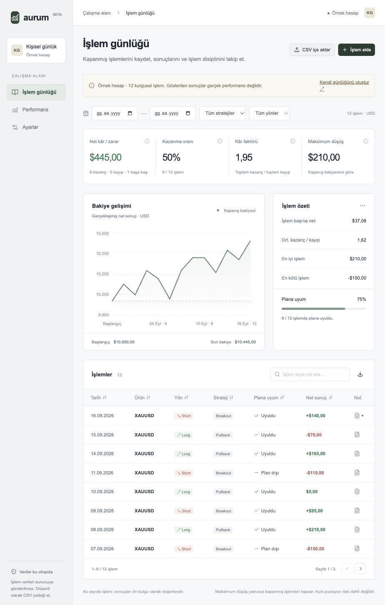

# Aurum — XAUUSD işlem günlüğü

Kapanmış altın işlemlerini kaydetmek, veri hatalarını bulmak ve performansı incelemek için geliştirilen veri analizi projesi. React arayüzü, Python/SQLite analiz hattı ve çalıştırılmış Pandas notebook’u içerir.

**Durum:** Çalışan prototip. Örnekler kurgusaldır. Gerçek aracı kurum raporuyla uçtan uca mutabakat ve dış kullanıcı denemeleri henüz yapılmadı. MetaTrader 5 ile doğrudan bağlantı veya işlem yürütme özelliği yoktur.



## Neler yapar?

- İşlem ekleme/düzenleme, not tutma, tarih/strateji/yön filtreleri, arama ve sıralama.
- CSV/TSV/XLSX/HTML tablolardan sütun eşleştirme ve aktarım önizlemesi.
- Net/brüt/masraf mutabakatı; hatalı tarih, eksik risk, bilinmeyen etiket ve olası tekrar kontrolleri.
- Net sonuç, kazanma oranı, kâr faktörü, kapanış bakiyesi düşüşü ve risk başına sonuç (R).
- Eksik risk verisini sıfır varsaymadan R kapsamını gösterme.
- Strateji ve plana uyum karşılaştırmaları.
- Tarayıcıda kalıcı kayıt; tam yedek ve filtrelenmiş CSV dışa aktarımı.
- Aynı dosyadan Python ile SQLite analitik kopyası, JSON ve Markdown raporu üretme.
- Pandas/SQL ve belirsizlik analizi içeren, internet gerektirmeyen notebook.

## Hızlı başlangıç

Node.js 22+ ve npm:

```sh
npm ci
npm run dev
```

Tarayıcı: http://127.0.0.1:5173

```sh
npm test
npm run build
```

Üretim çıktısı `dist/` altındadır. Statik sunucuda barındırılabilir. Node.js, React, Vite, Tailwind CSS, shadcn/ui, Radix UI, Recharts ve Lucide kullanılır.

## Python ve SQL analizi

Analiz hattı yalnızca Python 3.11+ standart kütüphanesini kullanır:

```sh
PYTHONPATH=python python3 -m aurum public/sample.csv --out reports/demo --synthetic
PYTHONPATH=python python3 -m unittest discover -s tests -p 'test_*.py'
```

Kendi dışa aktarımını analiz etmek için:

```sh
PYTHONPATH=python python3 -m aurum private-data/trades.csv --out private-data/analysis --initial 10000
```

Çıktılar: `analysis.sqlite`, `summary.json`, `REPORT.md`. SQLite, analiz için üretilen türetilmiş bir kopyadır; web uygulamasının ana veri deposu tarayıcı localStorage alanıdır. SQL şeması ve sorgular `sql/` altında bulunur.

Notebook: [Pandas ve SQL analizi](notebooks/aurum-analysis.ipynb). Çalıştırmak için `pip install -r requirements-analysis.txt`. Beş kod hücresi sıralı çalıştırılmış ve çıktıları kaydedilmiştir. Kurgusal veriler notebook’a gömülüdür; ağ erişimi gerekmez.

Örnek [analiz raporu](reports/demo/REPORT.md), gerçek performans iddiası taşımadan yöntemi gösterir.

## MetaTrader 5 desteğinin sınırı

Aktarım, kapanmış pozisyon tablosunu eşleştirir. Ham deal tablosu açılış, kapanış ve kısmi kapanışları birleştirmediği için desteklenmez. MT5 sürümü, rapor dili ve aracı kuruma göre başlıklar değişebilir; eşleştirme önizlemesi kullanıcı onayı ister. XLSX’te ilk sayfa, HTML’de en büyük tablo okunur; doğru bölüm ve başlık satırı seçilmelidir. PDF desteklenmez.

[MT5 rehberi](public/mt5-guide.html) · [Veri sözleşmesi](docs/DATA_DICTIONARY.md)

`public/mt5-example.csv` kurgusal bir pozisyon tablosudur; yerel MT5 raporunun birebir çıktısı değildir. Gerçek raporla doğrulama beklenmektedir.

## Hesaplamalar ve varsayımlar

- Net sonuç, hesap para birimindeki masraflar sonrası gerçekleşmiş sonuçtur.
- Brüt sonuç verilirse `net = brüt + işaretli komisyon + swap + ücret` ile doğrulanır. Hazır netten masraflar yeniden düşülmez.
- R = net sonuç / başlangıç fiyat riski. Kullanıcı riski doğrudan girebilir. Alternatif: `|giriş − ilk stop| / tick büyüklüğü × tick değeri × lot`. Tick değeri hesap para biriminde ve 1 lot için olmalıdır; sabit sözleşme büyüklüğü varsayılmaz. Fiyat riski masraf/kayma içermez.
- Kâr faktörü = toplam kazanç / mutlak toplam kayıp. Kayıp yoksa tanımsızdır.
- Kazanma oranı = kazanan işlem / tüm işlemler; başa baş işlemler paydaya dahildir.
- Düşüş, başlangıç bakiyesi dahil kapanış zirvesinden düşüştür. Açık pozisyon riski ve yatırma/çekme dahil değildir.
- Tarih ve varsa aracı kurum kapanış saatine göre sıralanır. Aynı tarih/saatte dosya sırası korunur. Saat dilimi dönüşümü yapılmaz.
- Filtreler aynı başlangıç bakiyesiyle alt küme analizi üretir. Para birimi seçimi yalnızca etikettir; kur dönüşümü değildir.
- Bootstrap keşif amaçlıdır, işlem bağımsızlığı varsayar; seri bağımlılık ve karıştırıcı değişkenler kontrol edilmez. Kurgusal/küçük veriyle strateji etkinliği veya nedensellik çıkarımı yapılmaz.

## Doğrulama

17 JavaScript testi ve 6 Python testi: risk hesapları, masraf mutabakatı, hatalı satırlar, ham deal reddi, tekrarlar, SQL toplamları ve Python/tarayıcı metrik uyumu. GitHub Actions yapılandırması bu kontrolleri ve üretim derlemesini çalıştırır; uzaktaki CI sonucu yayın sonrası doğrulanmalıdır.

Örnek 12 işlem için net 445, kazanma %50, maksimum mutlak düşüş 210; risk kapsamı 10/12. Bu sayılar yalnızca kurgusal veriye aittir.

## Gizlilik ve veri yönetimi

Dosyalar tarayıcıda işlenir. İşlem verileri sunucuya gönderilmez. Tarayıcı verilerini silmek günlük kayıtlarını siler; düzenli tam CSV yedeği alın. Port/cihaz/tarayıcı değişince kayıtlar otomatik taşınmaz. İçe aktarma mevcut günlüğün yerine geçer ve önce tam yedek seçeneği sunar.

Gerçek dosyaları `private-data/` içinde tutun; bu klasör Git tarafından dışlanır. Gerçek hesap raporlarını, erişim bilgilerini veya işlem geçmişini kamuya açık depoya yüklemeyin.

## Proje yapısı

| Konum | Amaç |
|---|---|
| `src/` | React uygulaması, aktarım eşleştirmesi |
| `public/analytics.js` | Tarayıcı hesaplama / doğrulama motoru |
| `python/aurum/` | Python doğrulama, rapor, SQLite |
| `sql/` | Şema ve analiz sorguları |
| `notebooks/` | Çalıştırılmış Pandas araştırması |
| `tests/` | İki dilde doğrulama ve uyum testleri |
| `reports/demo/` | Kurgusal veri raporu |
| `docs/` | Veri sözleşmesi, kullanıcı test planı, portföy açıklaması |
| `legacy/` | İlk prototip, yalnızca geçmiş referansı |

## Sonraki doğrulamalar

- Kullanıcının gerçek MT5 pozisyon raporuyla masraf ve toplam mutabakatı.
- [Kullanıcı deneme planı](docs/USER_TEST.md) ile geri bildirim toplama; henüz dış kullanıcı yok.
- Daha büyük gerçek veri setinde risk/strateji kontrolü ve zaman bağımlılığını hesaba katan araştırma.

Bu proje AI desteğiyle geliştirilmiştir. [Portföy anlatımı ve öğrenme soruları](docs/PORTFOLIO.md), çalışmayı anlayarak sunmaya yardımcı olur. Yalnızca doğrulanmış katkı ve sonuçlar CV’ye taşınmalıdır.

Lisans: [MIT](LICENSE). Kullanılan kaynaklar: [THIRD_PARTY.md](THIRD_PARTY.md).
